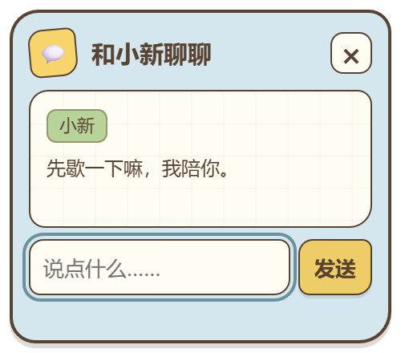
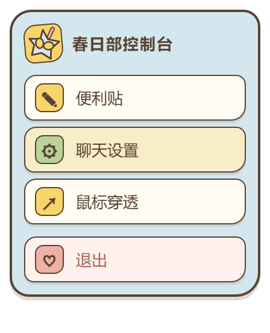
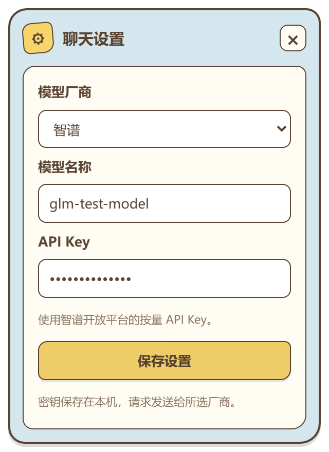
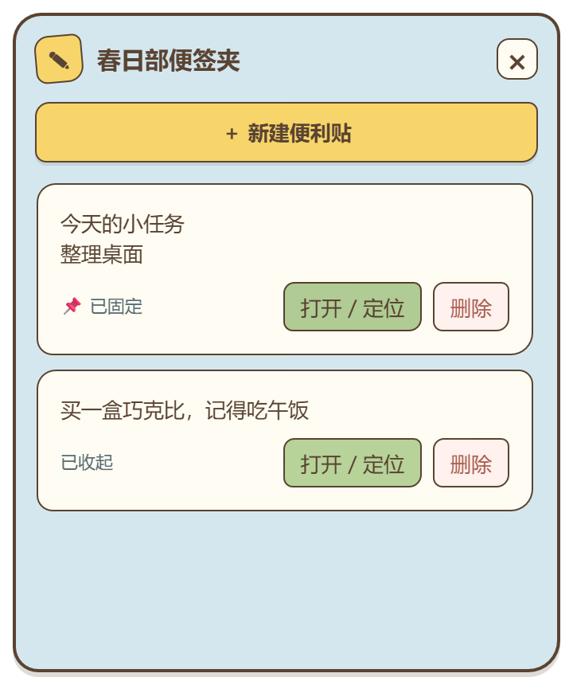

# 蜡笔小新桌宠

一款使用 Electron、React 和 TypeScript 开发的 Windows 桌面宠物。当前以自然眨眼的小新为常驻形象，提供角色互动、AI 聊天和多便利贴功能。本桌宠当前只是mvp版本，只涵盖了一些基础的动作和造型，后续会持续更新，如果不满意现有的动作造型，也可以下载源码自己DIY哦

## 实现的功能

### 桌宠互动

- 自然眨眼待机，透明无边框窗口常驻桌面
- 默认形象支持定时护眼走动提醒：默认每 60 分钟触发，可自定义 1～1440 分钟
- 提醒时显示休息提示并沿当前高度左右走动，碰到屏幕工作区边缘自动折返
- 双击小新结束本次提醒、恢复眨眼待机，从此刻重新计算下一个提醒周期
- 屏幕工作区边缘自动转身；按住人物、拖拽、聊天或打开控制面板时暂停
- 右键面板可设置提醒间隔，右键面板和托盘可开关提醒，设置自动保存；重启后重新计时
- 按住并拖动小新，自由调整桌面位置
- 双击小新进入害羞状态，几秒后恢复默认眨眼
- AI 回复期间切换为认真思考的动态表情
- 支持窗口置顶、显示或隐藏以及鼠标穿透
- 托盘常驻与单实例运行，避免重复启动多个桌宠

### AI 聊天

- 鼠标靠近小新时显示聊天入口
- 聊天框独立显示，不会改变小新的位置或造成画面闪动
- 回复显示在输入框上方，聊天与桌宠状态自然联动
- 支持 DeepSeek、Qwen、Kimi、智谱、豆包
- 支持自定义 OpenAI Chat Completions 兼容接口
- 用户自行填写模型名称和 API Key，配置只保存在本机

### 春日部便利贴

- 同时创建多张便利贴，内容自动保存
- 支持固定置顶、取消固定、关闭、重新打开和集中删除
- 支持黄、绿、粉三种便签颜色
- 可从左右边缘调整宽度、下边缘调整高度，尺寸自动保存
- 固定后隐藏新建和关闭按钮，点击便签时显示、失焦后隐藏
- 缩小后仍保留标题和第一行内容，装饰贴纸自然停留在底部边缘
- 提供小白、动感超人、巧克比等风格装饰
- 已固定的便利贴会在下次启动时恢复

养成系统和右键菜单中的聊天入口暂时由功能开关隐藏。鼠标悬浮时出现的聊天入口保持可用。

### 好友通信（本地开发版本）

本地代码新增了“好友消息”入口：通过好友码申请、同意后聊天，支持未读提醒、离线消息同步和自动重连。它与 AI 聊天独立，需要双方连接同一个通信服务。v1.0.4 包含好友消息客户端入口，通信需要双方连接同一个服务端。

本机启动通信服务与两个测试身份的完整步骤见 [好友通信开发说明](docs/SOCIAL.md)。

## 效果预览

### 桌面效果


### 功能界面

| AI 聊天 | 春日部控制台 |
| --- | --- |
|  |  |

| 聊天设置 | 春日部便签夹 |
| --- | --- |
|  |  |

## 下一步计划

- 添加更多自然、连贯的待机动作和互动动作，让小新更像真正生活在桌面上
- 增加更多符合角色特点的造型、服装和状态表现
- 继续优化小新高情商、全知但保留五岁童真感的人设与回复风格
- 根据问题类型优化思考时间、情绪识别和安慰类回复
- 完善安装包、版本更新与首次使用引导
- 在保证桌宠体验自然、轻量的前提下，探索更多实用功能

## 使用方法 Usage

### 系统支持

| 系统 | 支持情况 |
| --- | --- |
| Windows 10 64 位 | 当前支持 |
| Windows 11 64 位 | 当前支持 |
| macOS | 暂未适配与打包 |
| Linux | 暂未适配与打包 |

### 普通用户快速上手

普通用户只需要下载一个 `.exe` 文件，**不需要安装 Node.js，也不需要安装其他运行环境**。

1. 下载 [Windows 安装版](https://github.com/alhcrways/lbxn/releases/latest/download/Shinchan-Pet-1.0.4-Setup.exe)，或点击 [直接下载 Windows 便携版](https://github.com/alhcrways/lbxn/releases/latest/download/Shinchan-Pet-1.0.4-Portable.exe)。
2. 双击下载好的 `.exe`，小新就会出现在桌面上。

需要查找旧版本时，可以前往 [历史版本页面](https://github.com/alhcrways/lbxn/releases)。

### 基本操作

| 操作 | 效果 |
| --- | --- |
| 按住小新拖动 | 移动桌宠位置 |
| 双击小新 | 进入害羞状态，几秒后恢复 |
| 鼠标移到小新附近 | 显示聊天图标 |
| 点击聊天图标 | 打开或关闭聊天框 |
| 右键小新 | 打开“春日部控制台” |
| 开启鼠标穿透 | 可以操作小新后面的窗口 |
| 托盘“显示 / 隐藏小新” | 找回或暂时隐藏桌宠 |
| 托盘或控制台“退出” | 完全退出程序 |

### 配置 AI 聊天

第一次聊天前，右键小新打开“春日部控制台”，选择“聊天设置”：

1. 选择模型厂商。
2. 填写厂商提供的具体模型名称。
3. 填写自己的 API Key。
4. 保存设置后，将鼠标移到小新附近并点击聊天图标。

选择“自定义接口”时还需要填写接口地址。地址可以是 Base URL，也可以是完整的 `/chat/completions` 地址；远程服务要求 HTTPS，本机服务可以使用 HTTP。

聊天内容会发送给用户选择的模型服务商，因此需要网络连接。API Key、便利贴和桌宠状态均保存在本机。

### 使用便利贴

1. 右键小新选择“便利贴”，或者从系统托盘打开“便利贴 / 便签夹”。
2. 点击 `＋` 新建更多便利贴，输入内容后会自动保存。
3. 点击动感超人图钉，可以固定或取消固定便利贴。
4. 点击 `×` 会保存并关闭当前便利贴，之后可以从便签夹重新打开。
5. 删除操作位于便签夹中，避免误删正在编辑的内容。
6. 拖动便利贴下边缘可以上下调整高度。

## 从源码运行

以下内容面向希望修改或参与开发的用户。普通用户无需执行这些命令。

源码开发需要 Node.js 18 或更高版本。

```bash
git clone https://github.com/alhcrways/lbxn.git
cd lbxn
npm install
npm run dev
```

Windows 下也可以在执行 `npm install` 后双击：

- `开发模式启动.bat`：开发模式，支持热更新
- `启动桌宠.bat`：构建并启动当前源码

常用命令：

```bash
npm run typecheck   # TypeScript 类型检查
npm run build       # 构建渲染进程和 Electron 主进程
npm start           # 构建并启动生产模式
```

只生成一个免安装、可直接运行的便携版 `.exe`：

```bash
npm run dist:portable
```

同时生成安装版和便携版：

```bash
npm run dist
```

生成文件位于 `release/` 目录。将 `Shinchan-Pet-1.0.4-Portable.exe` 上传到 GitHub Releases 后，普通用户即可下载并直接运行。

仓库包含 GitHub Actions 发布流程。维护者推送 `v1.0.0` 这类版本标签后，GitHub 会自动构建便携版 `.exe` 并创建 Release。项目自行上传的 Release 附件只保留一个可运行文件。

## 本地数据

本地数据默认位于：

```text
%APPDATA%/shinchan-pet/shinchan-pet-data/
```

程序不会把 API Key 写入项目仓库。请勿分享本机数据目录中的配置文件。

## 项目结构

```text
src/
├─ main/                       Electron 主进程、窗口、IPC、存储和模型请求
├─ shared/                     共享类型、功能开关和角色人设
└─ renderer/
   ├─ components/              桌宠及功能界面
   ├─ data/                    配置、台词和窗口尺寸
   └─ public/character/        当前发布使用的角色素材
assets/
├─ icon.png                    托盘图标
└─ note-decor/                 便利贴装饰
docs/images/                   README 效果预览图
scripts/                       构建辅助和回归检查
```

当前角色素材包括默认眨眼、站姿回退、双击害羞和聊天思考状态。其他实验动作、像素形象和未开放换装素材暂不进入仓库。

## 模型兼容

厂商配置位于 `src/main/modelPresets.ts`。具体模型名称、账号权限、地域和额度以各服务商控制台为准。

- [DeepSeek API 文档](https://api-docs.deepseek.com/)
- [阿里云百炼 OpenAI 兼容接口](https://help.aliyun.com/zh/model-studio/compatibility-of-openai-with-dashscope)
- [Kimi API 指南](https://platform.kimi.com/blog/posts/kimi-api-quick-start-guide)
- [智谱开放平台文档](https://docs.bigmodel.cn/cn/guide/develop/openai/introduction)
- [豆包火山方舟文档](https://docs.volcengine.com/docs/ark/context-management?lang=en)

## 开源与素材说明

项目代码使用 [MIT License](LICENSE)。

“蜡笔小新”等角色名称和角色形象的相关权利归原权利方所有。仓库中的角色素材仅用于学习、交流和功能演示，不包含在 MIT 代码许可范围内。公开分发或商业使用前，请自行确认已获得所需授权。
